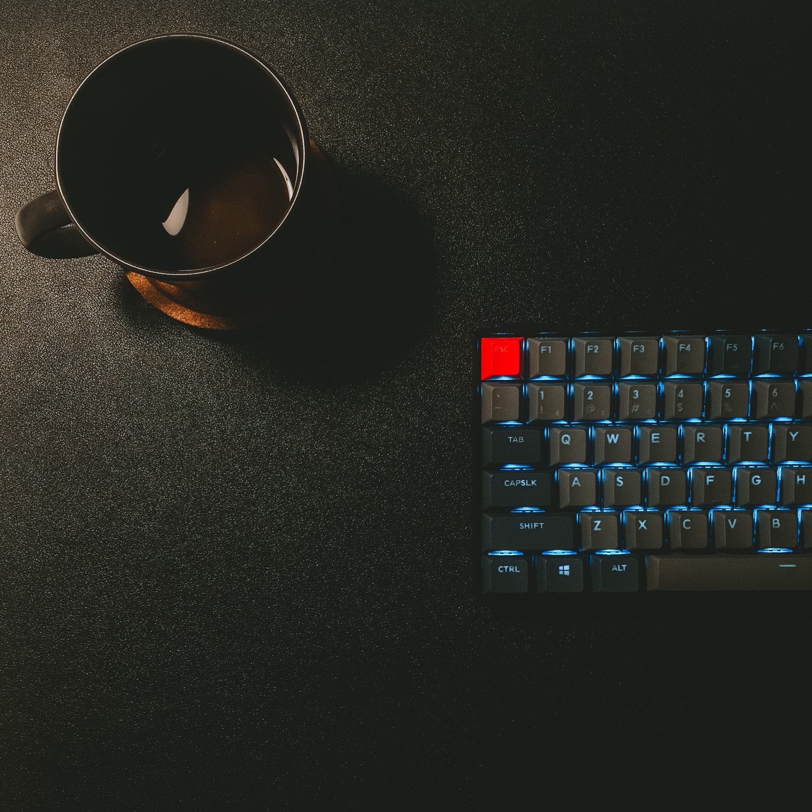
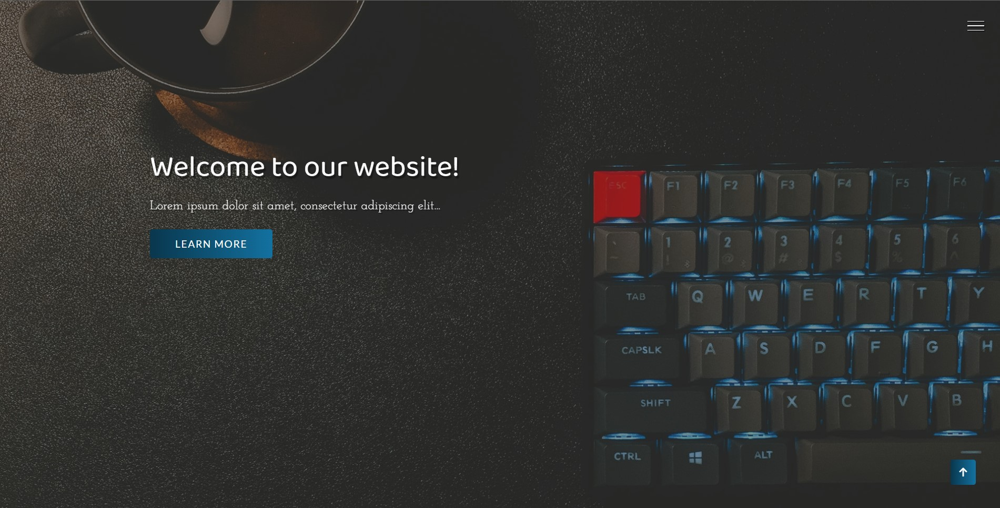
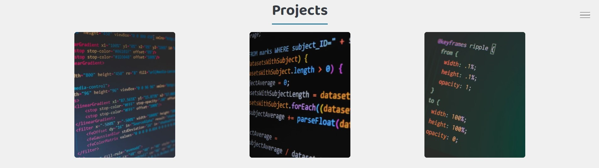
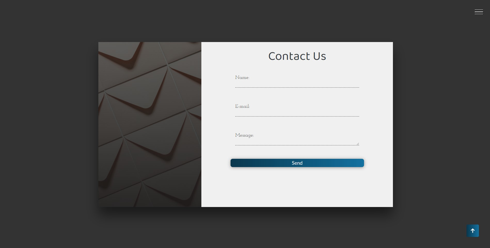
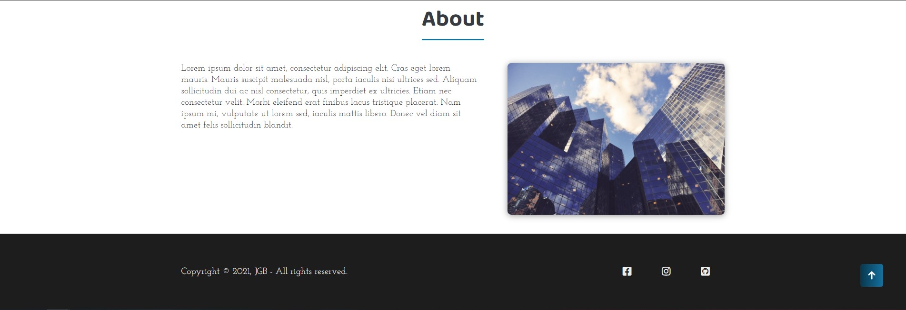

# 🎨 WebDesign Template

> A responsive landing page template built with plain HTML, CSS and JavaScript



## 📋 Table of Contents

-   [About the Project](#-about-the-project)
-   [Features](#-features)
-   [Technologies Used](#-technologies-used)
-   [Prerequisites](#-prerequisites)
-   [Installation and Setup](#-installation-and-setup)
-   [Running with Docker](#-running-with-docker)
-   [Project Structure](#-project-structure)
-   [Tests](#-tests)
-   [Contributing](#-contributing)
-   [License](#-license)

## 🎯 About the Project

**WebDesign Template** is a one-page landing page built by BortolettoTech to be used as a starting point for new sites. It has no framework and no build step — just HTML, CSS and vanilla JavaScript — so it can be dropped into any project and restyled quickly.

### Why use this template?

-   ✅ **No dependencies**: no build tools, no framework, no package manager required
-   ✅ **Responsive**: adapts from desktop down to mobile
-   ✅ **Ready-made sections**: hero banner, project showcase, about and contact
-   ✅ **Easy to theme**: colors, fonts and spacing centralized in one stylesheet
-   ✅ **Containerized**: ships with a Docker image for instant deployment

## 🚀 Features

-   **Hero banner** with animated entrance and a call-to-action button
-   **Sliding lateral menu** with a hamburger toggle for navigation and social links
-   **Project showcase** with hover-reveal cards
-   **About section** with a two-column layout
-   **Contact form** with floating labels (front-end only, no backend wired up)
-   **Back-to-top** shortcut and smooth scrolling between sections

## 🛠 Technologies Used

-   **HTML5** - page structure
-   **CSS3** - styling, animations and responsive layout
-   **JavaScript (vanilla)** - menu toggle and small interactions
-   **Font Awesome** - icons
-   **Google Fonts** - typography (Baloo Da 2, Josefin Slab, Lato)
-   **Docker & Nginx** - containerized static hosting

## 📋 Prerequisites

To run the project locally, you need one of:

-   A modern browser and a code editor, e.g. [VSCode](https://code.visualstudio.com/) ([Git](https://git-scm.com) to clone it)
-   **Docker** ([Download](https://docs.docker.com/get-docker/)) to run it containerized

## 🚀 Installation and Setup

### 1. Clone the Repository

```bash
git clone https://github.com/bortolettojoaog/web_design.git
cd web_design
```

### 2. Open the Project

```bash
# Open in VSCode
code .

# Then open index.html directly in a browser,
# or serve it with the "Live Server" extension
```

## 🐳 Running with Docker

The project ships with a `Dockerfile` that builds a small Nginx image to serve the static files.

```bash
# Build the image
docker build -t web-design-template .

# Run the container
docker run -d -p 8080:80 --name web-design-template web-design-template
```

The site will be available at: `http://localhost:8080`

## 📁 Project Structure

```
web_design/
├── index.html              # Page markup
├── css/
│   └── style.css           # All styling, animations and media queries
├── js/
│   └── script.js           # Lateral menu toggle and small behaviors
├── assets/
│   ├── images/              # Banner and section images
│   └── icons/               # Favicons and PWA icons
├── nginx/
│   └── default.conf         # Nginx config used by the Docker image
├── Dockerfile               # Builds the Nginx image for deployment
└── site.webmanifest         # PWA manifest
```

## ✔️ Tests

<h1 align="center">
    
    
    
    
</h1>

## 🤝 Contributing

Contributions are welcome! To contribute:

1. Fork the project
2. Create a branch for your feature (`git checkout -b feature/new-feature`)
3. Commit your changes (`git commit -m 'Add new feature'`)
4. Push to the branch (`git push origin feature/new-feature`)
5. Open a Pull Request

## 📄 License

This project is under the MIT license. See the [LICENSE](LICENSE) file for more details.

---

<div align="center">
  <p>Developed with ❤️ by <strong>BortolettoTech</strong></p>
  <p><a href="https://www.linkedin.com/in/bortolettojoaog/">See my LinkedIn</a></p>
  <p>⭐ If this project was helpful, consider giving it a star!</p>
</div>
